[简体中文](README.md) | **English**

# Ninja Gaiden Black / Ninja Gaiden (2004) · native PC port

An unofficial native Windows port of Ninja Gaiden Black (original Xbox). Four disc images are supported:

- the original US release NINJA GAIDEN BLACK (English)
- the basic edition va-zh-x2 (Chinese / English)
- the Hurricane edition vb-zh-x2.1 (Chinese / English)
- the Hurricane edition vb-jp-x2.1 (Japanese / English)

From 2.0.0 it also runs the first Ninja Gaiden (2004, the US disc) with its Hurricane Packs: switch the launcher to "2004" at the top left. With the packs, the Master Ninja Tournament plays online (Insignia) and "NEW NOTICE!" downloads notices and other content; content you do not want uninstalls in the launcher.

This repository only publishes the program; the source code (GPL-2.0) is in [ngb-pc-native-port](https://github.com/akirahayabusa/ngb-pc-native-port).

## Smoothness settings

The goal is a smooth experience in every setup; choose the one that matches your display and habits.

**High refresh display, exclusive fullscreen, fixed 60 Hz**

In exclusive fullscreen, turn on "60 Hz with V-Sync"; the display switches from 120 / 144 / 165 / 240 Hz to 60 Hz.

"Steady game speed" must be on as well. With only the 60 Hz switch on, the tick follows kernel vblank after switching to 60 Hz, falls to 47, and a 30 fps cutscene drops to 24.

- Display: exclusive fullscreen
- "60 Hz with V-Sync": on
- Steady game speed: on
- V-Sync: on
- Low-latency present: off

The cost is losing the high refresh rate; entering the game / switching fullscreen goes black for a moment, and Alt+Tab carries some risk.

**60 Hz display, exclusive fullscreen**

- Display: exclusive fullscreen
- Steady game speed: on
- V-Sync: on
- Low-latency present: off
- "60 Hz with V-Sync": off (it does nothing on a 60 Hz display)

**60 Hz display, windowed / borderless**

- Display: windowed or borderless
- Steady game speed: off
- V-Sync: on
- "60 Hz with V-Sync": off

Windowed / borderless goes through Windows' desktop composition (DWM) and does not switch the display mode.

**High refresh display, no 60 Hz switch**

- Steady game speed: on
- "60 Hz with V-Sync": off

Keep the high refresh rate; the game still runs at 60.

## Screenshots

From the game's own attract demo (it plays when the title screen is left alone) and from saves, rendered at 1440 lines and scaled down.

**Title screens** (16:9)

Ninja Gaiden Black, Hurricane vb-zh-x2.1 · Ninja Gaiden Black, original US release · Ninja Gaiden (2004)

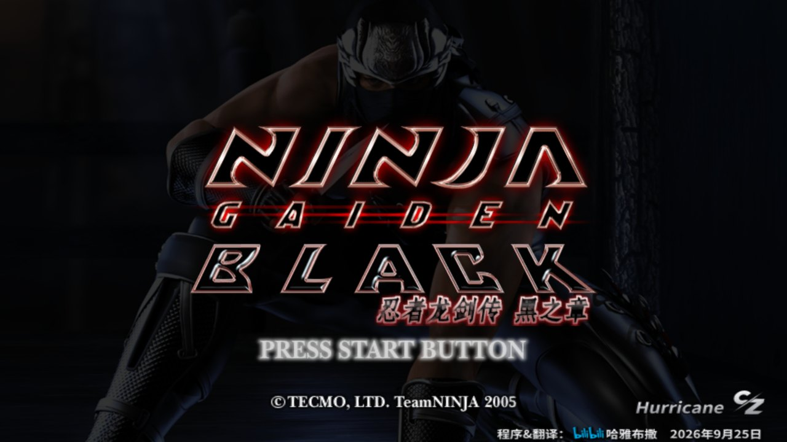
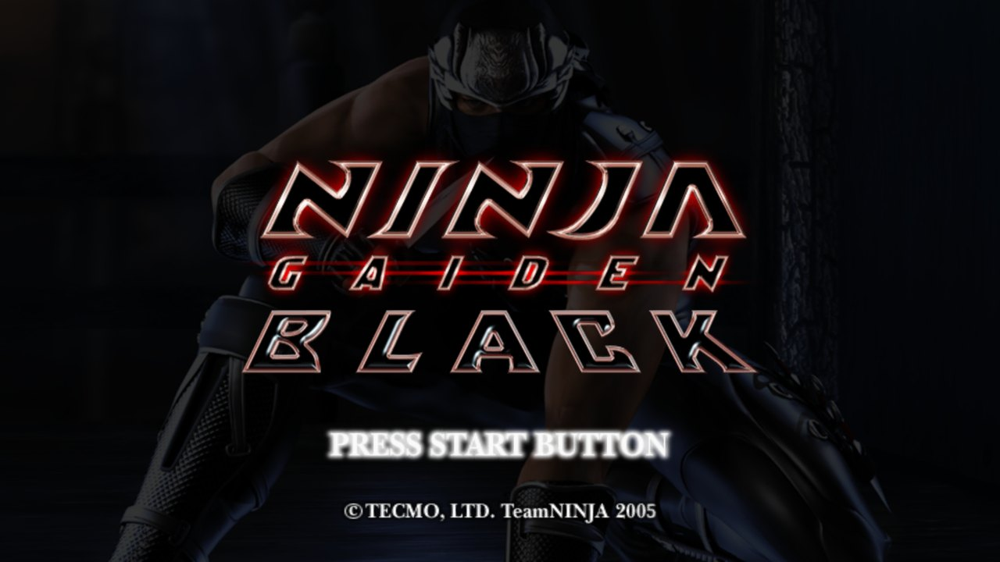
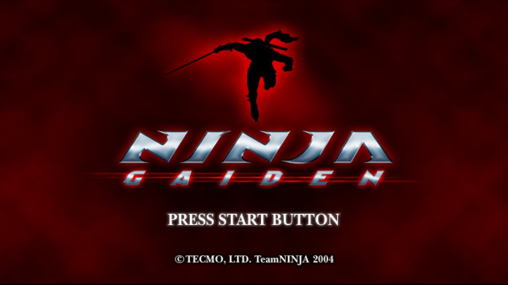

**Ninja Gaiden Black** (16:9)

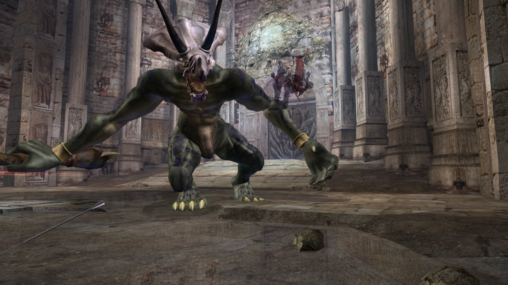
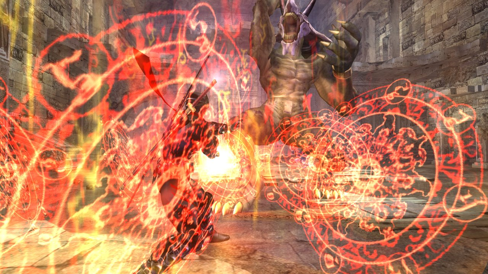
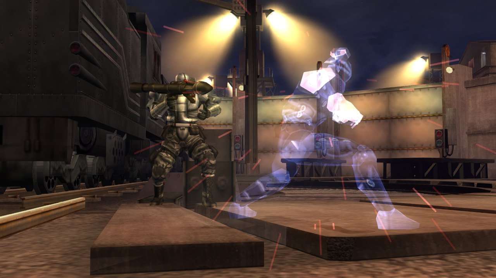

**Screen shapes** (Ninja Gaiden Black, the same moment): 4:3, 16:9, 16:10, 21:9. At 16:10 and 21:9 the picture is wider and the HUD sits at the sides.

4:3 · 16:9

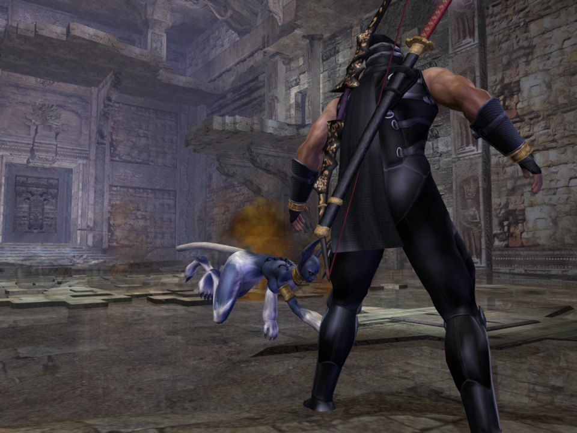
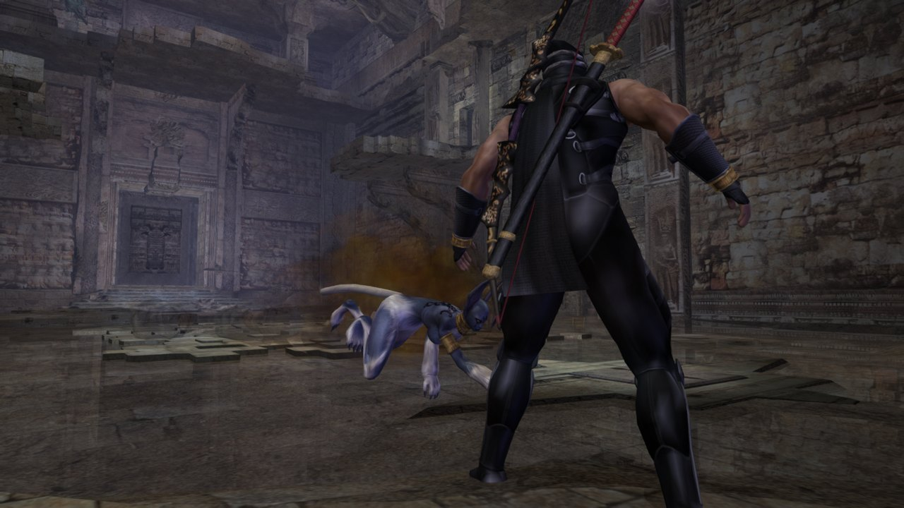

16:10 · 21:9

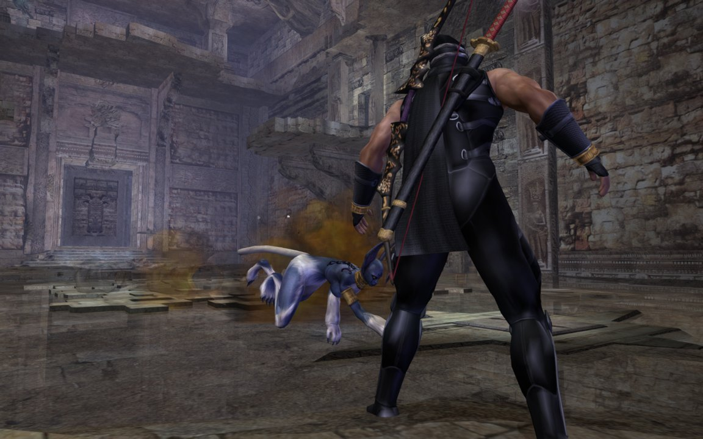
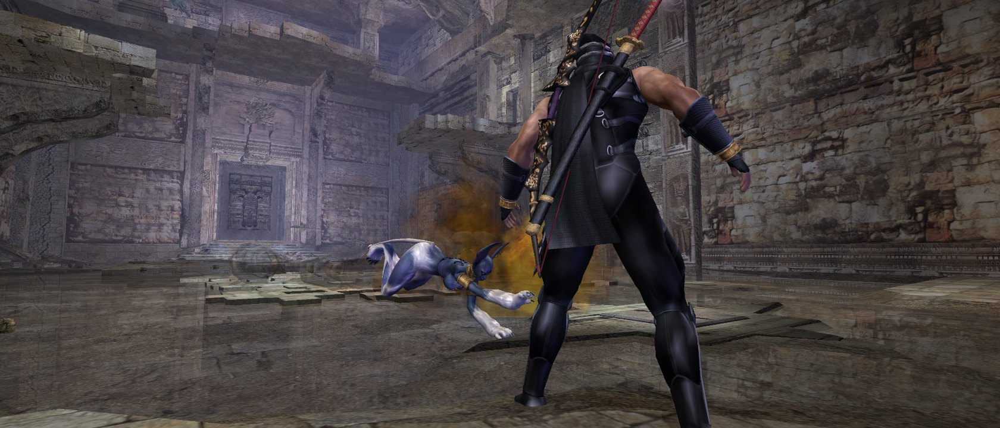

**Ninja Gaiden (2004)**: 16:9, 4:3, 21:9 and the menu.

16:9 · 4:3

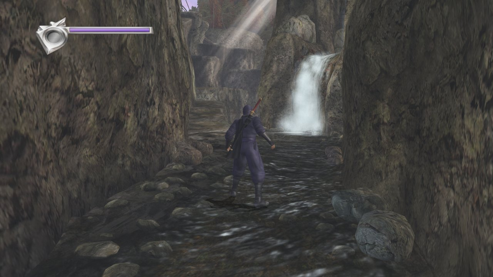
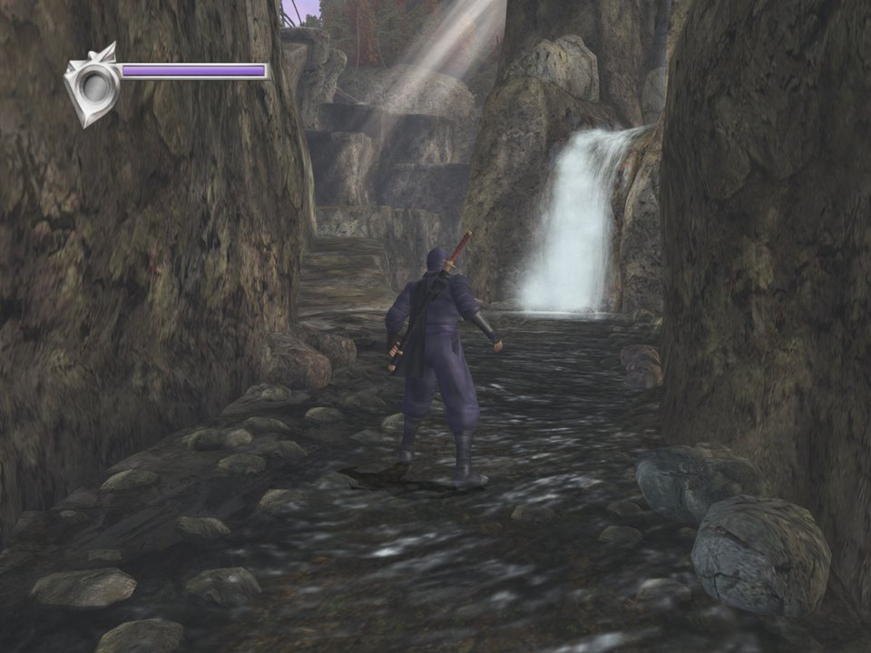

21:9 · Menu

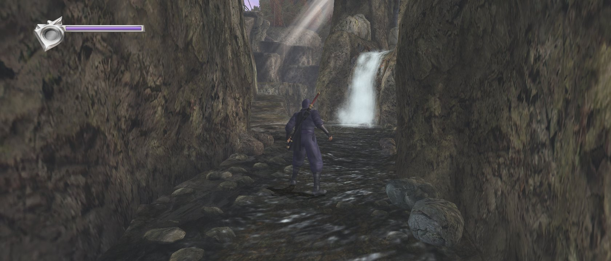
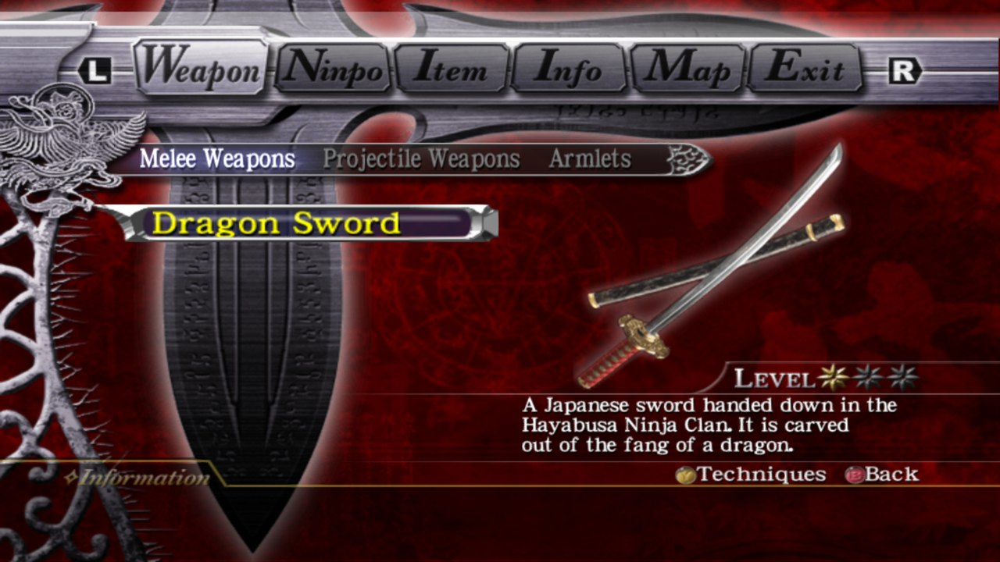

## Download

- [GitHub Releases](https://github.com/akirahayabusa/ngb-pc-native-port-release/releases): stable `ngb-hurricane-pc-2.2.37.3-win32.zip`.
- Test build **2.2.37.3-t**: `ngb-hurricane-pc-2.2.37.3-t-win32.zip`. It only adds the Start page's **Steady game speed** switch: turn it on when CG, cutscenes or combat clearly run fast or slow. The game clock stays at 59.94 Hz, not the screen; it does not cap frames, and it applies from the next start. This is not a stable release; use 2.2.37.3 if you hit a problem.
- Quark Netdisk: <https://pan.quark.cn/s/c210df004321>.
- Project site: <https://akirahayabusa.github.io/ngb-hurricane-patch/>

`-symbols.zip` holds debug symbols, needed only to report a crash.

## How it differs from the recompiled version

The x86 code in the original `default.xbe` runs unchanged on the PC's CPU. The Xbox's system parts (kernel, Direct3D, sound, controllers) are reimplemented on the PC by the loader.

- The game logic is the original code, so translating the code cannot add new bugs.
- Direct3D 9 is enough; integrated graphics run it at a full 60 fps.
- The arcade version (and, in the Hurricane editions, the SFC trilogy) start from the main menu.
- Saves are in the standard Xbox format and can be exchanged with xRevive.
- Controllers: Xbox, PS3/4/5, Switch Pro, Joy-Con and DirectInput pads work directly, all with rumble.
- Optional Insignia online leaderboards; 2004's Master Ninja Tournament. From 2.2.0 no xemu is needed: make a console, register it and make a gamertag in the launcher, or import accounts from xemu.
- One click in the launcher re-signs saves, so saves from another Xbox, from xemu or from another player load.

## To play

1. Download the zip and extract it anywhere.
2. Open `NGB-Hurricane\Ninja Gaiden Black&2004 PC Launcher.exe` and install your own game image (`.iso`, one of the four above) on the Install page. For 2004, switch to "2004" at the top left first and choose the 2004 image; the Hurricane Packs install further down the same page.
3. Start from the Play page. Once installed, you can also double-click `Ninja Gaiden Black.exe` (Black) or `Ninja Gaiden.exe` (2004).

Upgrading from 2.2.36.3 or earlier: the launcher is now `Ninja Gaiden Black&2004 PC Launcher.exe` and the game program is two, `Ninja Gaiden Black.exe` (Black) and `Ninja Gaiden.exe` (2004). After extracting over the old folder you can delete the old `Ninja Gaiden Black Any.exe` and `Ninja Gaiden Black Any Launcher.exe`; point desktop shortcuts and non-Steam games in Steam at the new launcher. Saves and settings are kept; the launcher carries the graphics preference over from the old program. Windows Firewall may ask once more for the new programs when you play online.
Upgrading from 1.1.12 or earlier: from 1.2.0 the programs are `Ninja Gaiden Black Any.exe` / `Ninja Gaiden Black Any Launcher.exe`. After extracting over the old folder you can delete the old `Ninja Gaiden Black Hurricane.exe` and `Ninja Gaiden Black Hurricane Launcher.exe`, and make desktop shortcuts again. Saves and settings are kept.

**Requires**: Windows 10 / 11 (Steam Deck / Linux: see below) and a Direct3D 9 graphics card (integrated graphics work); nothing else to install.

**The game is not included**: use your own legally obtained game image.

The full guide (settings, online play, known issues) is `README.en.md` in the zip.

## Running on Windows and Linux

### Windows

- **Needs**: Windows 10 or 11 (64-bit; the program itself is 32-bit), a graphics card with Direct3D 9 (an integrated one will
  do), and your own game image. Nothing else to install.
- **Graphics card**: at the first start, if you have not set a Windows "graphics preference" for the game program, it sets
  "high performance", so a laptop with a dedicated card uses it. A preference you set is left alone.
- **Log**: started from the launcher, `logs\black.log`; started by double-clicking a game program (`Ninja Gaiden Black.exe` / `Ninja Gaiden.exe`), `black.log`
  next to it. Please attach it to a report.
- **When the game cannot start** it says why (from 2.2.36.3): when Direct3D cannot start, for example, which step failed, what the
  error code means, the card and its driver version, and what to try - then it exits instead of crashing.
- A few anti-virus programs give false alarms; see "Anti-virus warnings" below.

### Linux (Wine / Proton)

There is no separate Linux build: the Windows one runs in Wine or Proton.

**Tested so far**:

| Setup | State |
|---|---|
| Standard Wine 10.0 (WineHQ's own packages, Ubuntu 24.04; the author, 2026-11-18, 2.2.36.2 / 2.2.36.3) | Start, the opening movie, the title, the main menu and leaving from the main menu all fine, with no error. Through Wine's own Direct3D translation (wined3d), rendered in software under WSL, so speed was not measured |
| Batocera (Wine 10, AMD A8-7500 / GT640; one player, 2.2.36.x) | Plays. 2.2.36.2 fixed "not enough free blocks" at every start and the launcher's boxes; **some CG movies stand still with only the subtitles moving - under investigation** (the opening movie plays fine in standard Wine 10) |
| Steam Deck, Proton 11.0-2 (a player, 1.1.x) | Ran; two differences between Proton and Windows were fixed then (1.1.3 a "dirty disc" message at start, 1.1.4 a crash after the warning screen); no Deck report on later versions yet |

**Steam Deck**:

1. In desktop mode, unpack the archive.
2. Steam -> "Add a Game" -> "Add a Non-Steam Game", choose `Ninja Gaiden Black&2004 PC Launcher.exe`.
3. Right-click it -> "Properties" -> "Compatibility", tick "Force the use of a specific Steam Play compatibility tool" and choose Proton (11.0-2 was tried; Experimental works too).
4. Start it, install the game or choose its folder in the launcher, then play. Later, start it from the library in game mode.
5. In Proton the Deck's controls are an Xbox pad. The screen is 16:10: choose "Widescreen (16:10 monitor)" under the launcher's aspect setting.

**Other Linux (Wine, Lutris, Bottles, Batocera...)**:

1. Use Wine 10 or newer. **The program is 32-bit, so the card's 32-bit drivers are needed**, for example:
   - Debian / Ubuntu: `sudo apt install libgl1-mesa-dri:i386 mesa-vulkan-drivers:i386` (NVIDIA's own driver: its 32-bit libraries)
   - Arch: `lib32-mesa` and `lib32-vulkan-radeon` / `lib32-vulkan-intel` / `lib32-nvidia-utils`

   Without them the game shows what failed and what to install, and exits (from 2.2.36.3).
2. Run the launcher: `wine "Ninja Gaiden Black&2004 PC Launcher.exe"`, install the game, set things up and play; or run
   `wine "Ninja Gaiden Black.exe"` (Black) or `wine "Ninja Gaiden.exe"` (2004) directly. With Steam, Proton as in steps 2-4 for the Deck works too.
3. Batocera and similar systems: try another Wine runner, or switch DXVK on or off. DXVK turns Direct3D 9 into Vulkan and is usually
   faster than Wine's own translation (not measured by the author); outside Batocera, `winetricks dxvk`.

**Good to know on Linux**:

- **Chinese in the launcher and in error boxes**: Wine usually has no Chinese font. From 2.2.36.2 the launcher then shows in
  English with no icons; from 2.2.36.3 error boxes show their English part only. For Chinese, copy any Chinese font (Windows'
  `msyh.ttc`, `NotoSansCJK-Regular.ttc`, WenQuanYi) into the Wine prefix's `drive_c/windows/Fonts`. The game's own Chinese
  comes from its own font and is not affected.
- **Free space**: some file systems tell Wine nothing about free space (0). From 2.2.36.2 the program then writes 1 MB to see
  whether the disk is full, instead of a false "not enough free blocks".
- **A crash when a character loads**: most likely a cache written wrong (an old build killed, or the machine switched off, while it
  hung). Delete what is in `savedata`'s `Partition4` and `Partition5` (only the cache, the game rebuilds it; **leave `Partition1`,
  your saves, alone**). The first start after that rebuilds the cache and the opening movie may be garbled once; then it is fine.
- **Shaders**: the game compiles shaders with Wine's / Proton's own `d3dcompiler_47`; if things are missing from the picture, try
  `winetricks d3dcompiler_47`.
- Online play (Insignia) has not been tried under Wine.
- Please send the log (see Windows above) with an issue.

## Anti-virus warnings

A few anti-virus programs flag the game program (`Ninja Gaiden Black Any.exe` up to 2.2.36.3, now `Ninja Gaiden Black.exe` / `Ninja Gaiden.exe`) as a trojan. On VirusTotal it is three to five engines out of about seventy, all machine-learning or generic heuristics (such as Elastic, Malwarebytes and VBA32), none naming a malware family; Windows Defender, Kaspersky, ESET, BitDefender and the rest report it clean.

It is a false positive. The game program is only a small stub holding the Xbox's memory range; at run time `blackrt.dll` puts the original game code there and patches it, and nothing is code-signed, so to these models it looks like a packed program. Since 2.2.23 the game program has Data Execution Prevention (DEP) on and a manifest, so it looks more like an ordinary program, though false positives may not disappear entirely. The full source is public: <https://github.com/akirahayabusa/ngb-pc-native-port>.

- After downloading, check the zip against the SHA-256 in the release notes to make sure it was not swapped.
- If it is blocked, add the game folder to your anti-virus exclusions.
- See [issue #6](https://github.com/akirahayabusa/ngb-pc-native-port-release/issues/6).

## Smoothness (from 2.2.31)

From 2.2.31 the first time an area or a cutscene shows no longer stutters: shaders, the game's vertex programs, the
graphics driver's internal programs, textures and the cutscenes' ripple textures are prepared at start (about 0.3 s
longer). What is prepared comes from the title, the attract demo and a recorded play of chapters 1-2 by the author;
anything from chapter 3 on that was not prepared stutters only the first time. The pause of about 0.6 s on entering
play from the main menu is the game tidying its hard-disk cache, as on the console.

2.2.32 completes the seeds (the author's play of chapters 1-4, players with MSAA, NG2004's title update) and ships the
ripple textures, the last fixed spike of a new player's first start; every graphics setting was measured, none compiles a
game shader in play.

2.2.33 adds the low-latency present (off by default again from 2.2.34, see below): a picture goes out as soon as it is drawn instead of on the next beat; from the
game reading the pad to the picture going out, about 16 -> 2.5 ms windowed and 18 -> 8.5 ms in exclusive fullscreen, with
the frame rate and game speed unchanged (the launcher's Graphics page turns it off). The seed lost its records repeated
per camera angle (half the size) and gained the author's NG2004 play.

2.2.34: on a high-refresh screen, exclusive fullscreen with V-Sync switches to 60 Hz and no longer judders (the
launcher's Graphics page turns it off); at 60 Hz in exclusive fullscreen the game's beat follows the display's own
vblank, which ends the cutscene movies slowing down and stuttering. The low-latency present is off by default again
(experimental): a player found windowed play on a 60 Hz display with integrated graphics less smooth with it on; until that
is sorted out, turn it on only if it feels right to you.

2.2.35: windowed on a 120 Hz screen the picture is even (about 45% of the frames stayed the wrong time before); the
occasional few seconds of repeated and skipped frames are fixed; exclusive fullscreen no longer slows down on a
variable-refresh (G-SYNC / FreeSync) screen. The low-latency present is redone and checked frame by frame from a screen
capture: no longer visibly less smooth on integrated graphics, recommended with a dedicated GPU driving the screen (still
off by default). With it off, input lag is as in 2.2.34.

Each cause, its switch and the measurements are in the [2.2.31](https://github.com/akirahayabusa/ngb-pc-native-port-release/releases/tag/v2.2.31) and
[2.2.32](https://github.com/akirahayabusa/ngb-pc-native-port-release/releases/tag/v2.2.32) and
[2.2.33](https://github.com/akirahayabusa/ngb-pc-native-port-release/releases/tag/v2.2.33) and
[2.2.34](https://github.com/akirahayabusa/ngb-pc-native-port-release/releases/tag/v2.2.34) and
[2.2.35](https://github.com/akirahayabusa/ngb-pc-native-port-release/releases/tag/v2.2.35) release notes and the source README's Smoothness section.

## Legal

This project is not affiliated with or endorsed by Koei Tecmo, Team NINJA or Microsoft. Ninja Gaiden is a trademark of Koei Tecmo; Xbox is a trademark of Microsoft.

The program is licensed under the GNU General Public License, version 2 or (at your option) any later version; see `LICENSE`.

## Thanks

- [black-pc](https://github.com/Spark198rus/black-pc) (Spark198rus): the loader this project is built on.
- [ngbrecomp](https://github.com/gamboozino/ngbrecomp) (GPL-2.0): the D3D symbol table of the Ninja Gaiden main program; the shader seed, the game's vertex programs shipped as their place only, the saved volumes at a cold start (#182), the compile budget (#94, #21; off by default here), the HUD's in-play test, the chapter-2 pond's LOD bias (#16) and the load meter (#50, #96) follow it (reimplemented in this project's structure, no code copied). Each is listed in the source README's Thanks.
- [xemu](https://xemu.app), [Cxbx-Reloaded](https://github.com/Cxbx-Reloaded/Cxbx-Reloaded), [XbSymbolDatabase](https://github.com/Cxbx-Reloaded/XbSymbolDatabase), [genma-pc](https://github.com/w1284603830/genma-pc), [SDL3](https://libsdl.org).

Developed by 哈雅布撒 (bilibili)
