[简体中文](README.md) | **English**

# Ninja Gaiden Black / Ninja Gaiden (2004) · native PC port

An unofficial native Windows port of Ninja Gaiden Black (original Xbox). Four disc images are supported:

- the original US release NINJA GAIDEN BLACK (English)
- the basic edition va-zh-x2 (Chinese / English)
- the Hurricane edition vb-zh-x2.1 (Chinese / English)
- the Hurricane edition vb-jp-x2.1 (Japanese / English)

From 2.0.0 it also runs the first Ninja Gaiden (2004, the US disc) with its Hurricane Packs: switch the launcher to "2004" at the top left. With the packs, the Master Ninja Tournament plays online (Insignia) and "NEW NOTICE!" downloads notices and other content; content you do not want uninstalls in the launcher.

This repository only publishes the program; the source code (GPL-2.0) is in [ngb-pc-native-port](https://github.com/akirahayabusa/ngb-pc-native-port).

## Screenshots

From the game's own attract demo (it plays when the title screen is left alone) and from saves, rendered at 1440 lines and scaled down.

**Title screens** (16:9)

Ninja Gaiden Black, Hurricane vb-zh-x2.1 · Ninja Gaiden Black, original US release · Ninja Gaiden (2004)

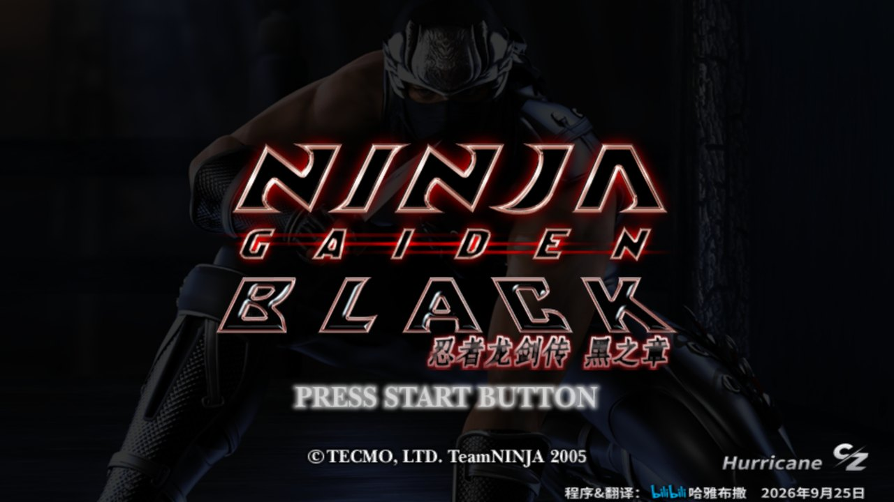
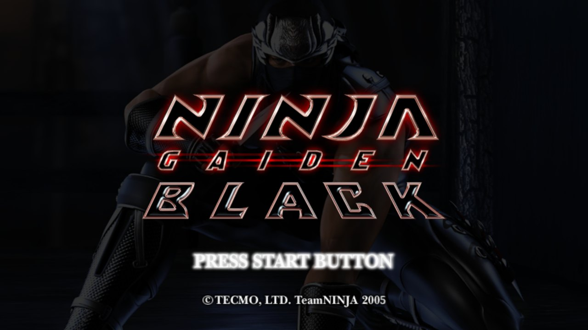
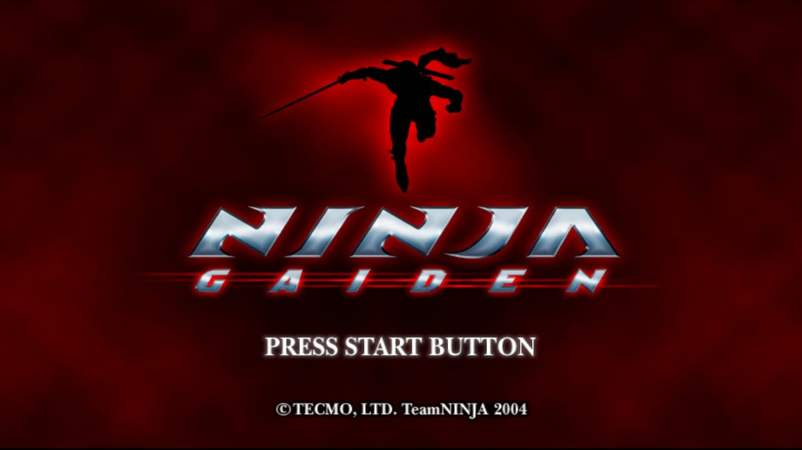

**Ninja Gaiden Black** (16:9)

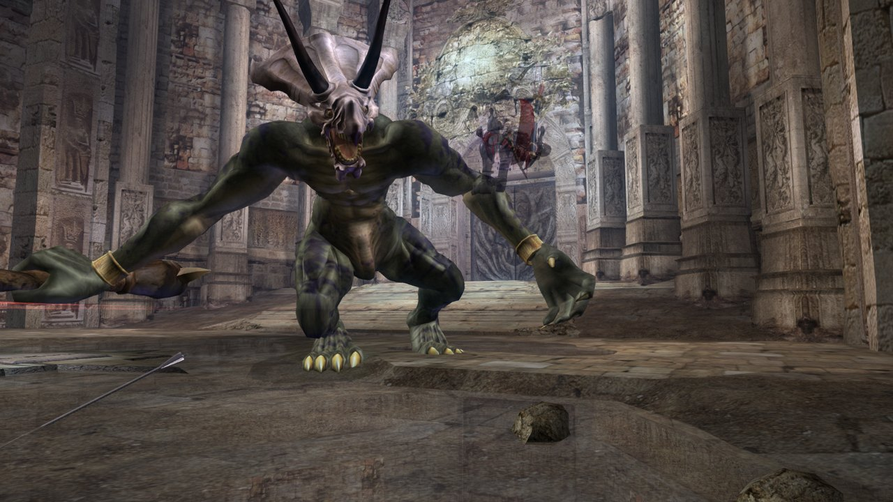
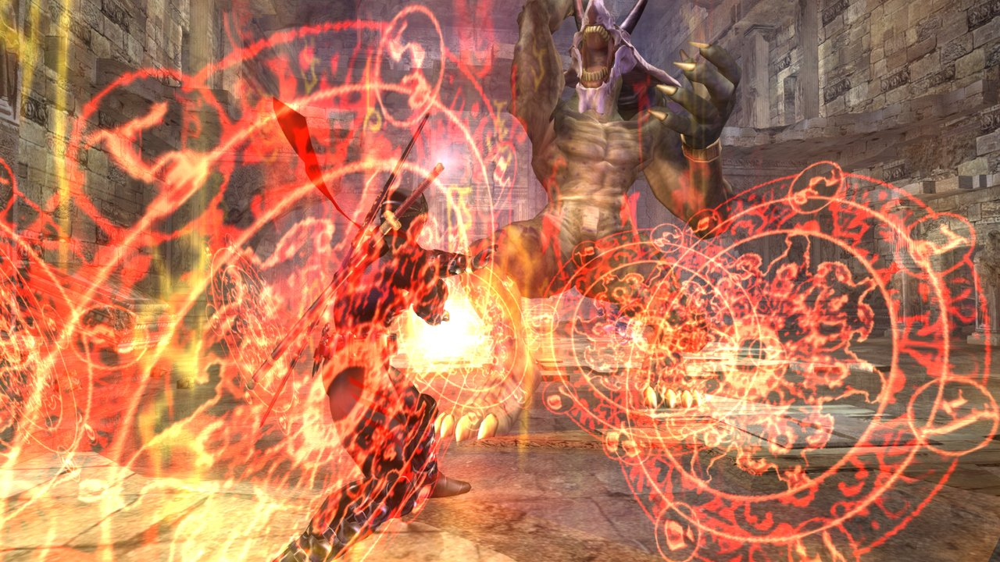
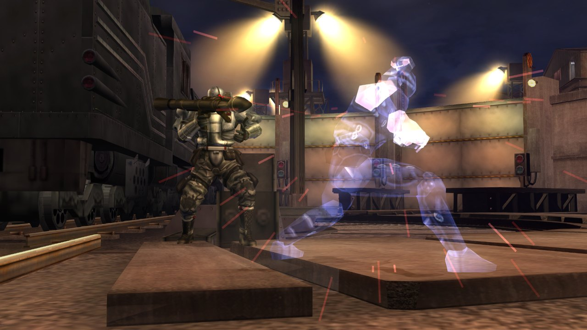

**Screen shapes** (Ninja Gaiden Black, the same moment): 4:3, 16:9, 16:10, 21:9. At 16:10 and 21:9 the picture is wider and the HUD sits at the sides.

4:3 · 16:9

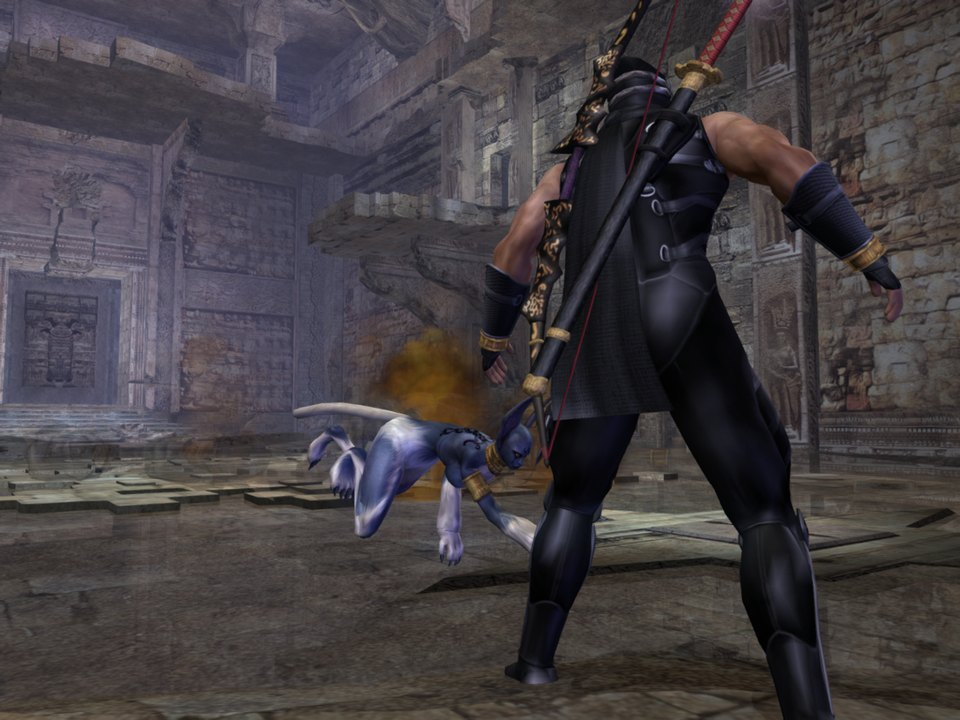
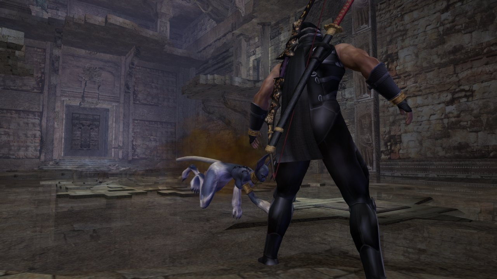

16:10 · 21:9

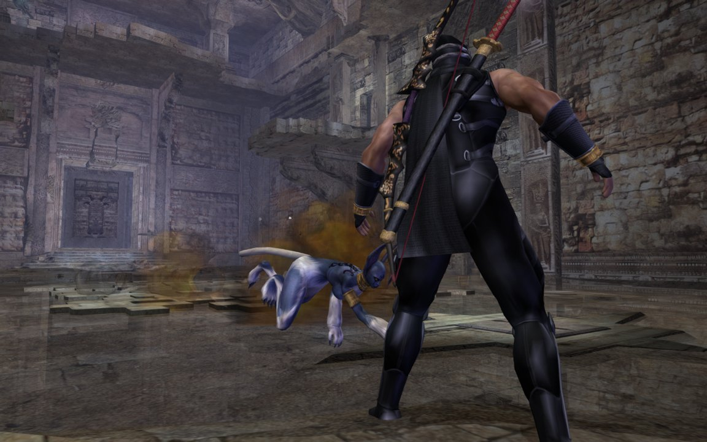
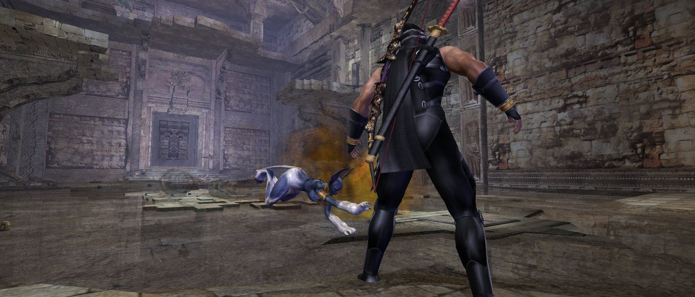

**Ninja Gaiden (2004)**: 16:9, 4:3, 21:9 and the menu.

16:9 · 4:3

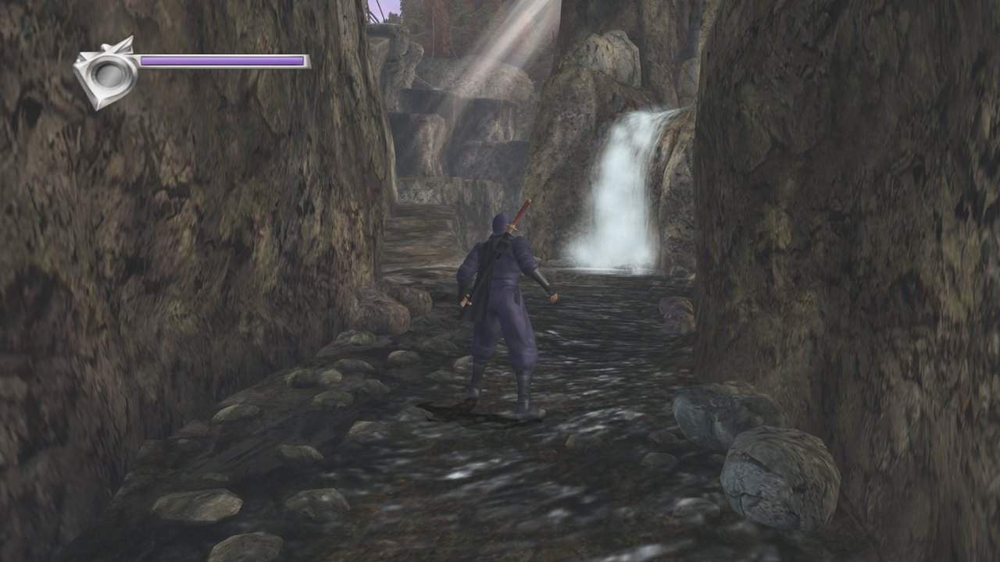
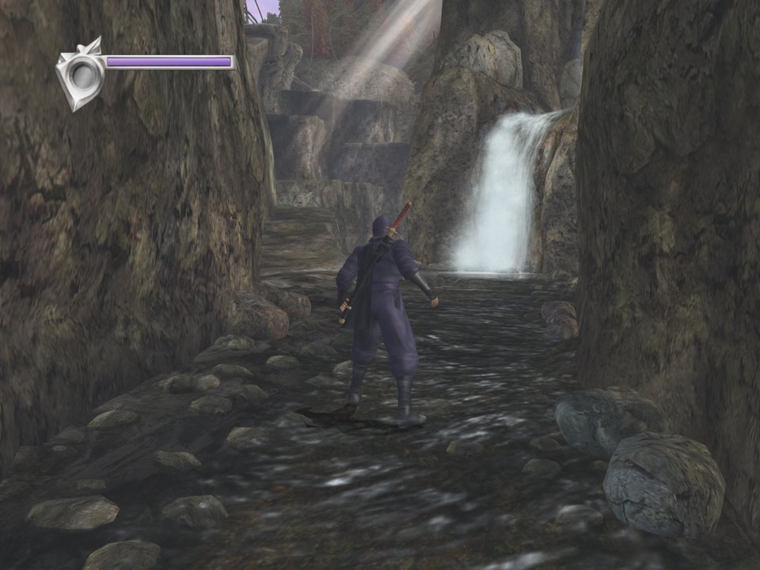

21:9 · Menu

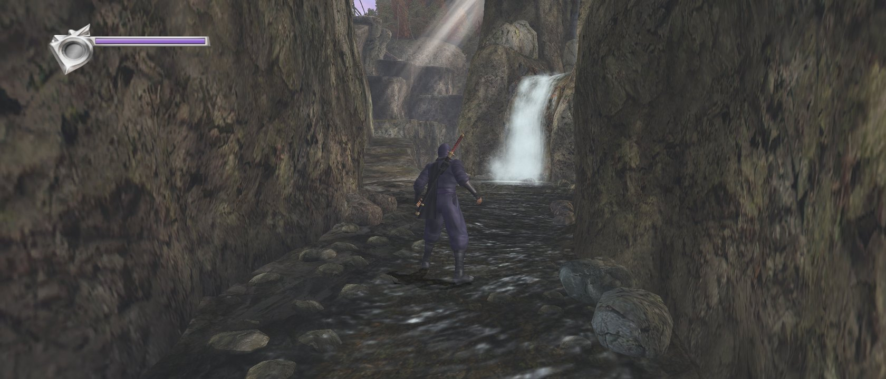
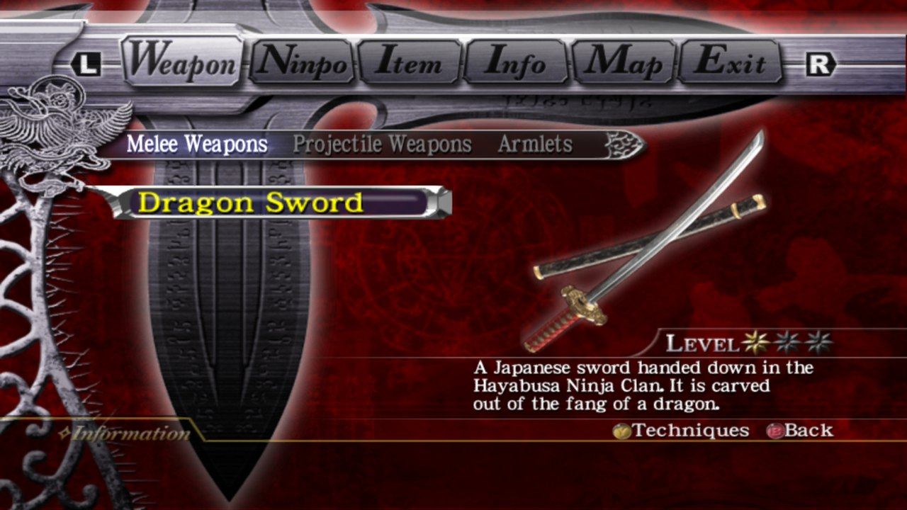

## Download

- [GitHub Releases](https://github.com/akirahayabusa/ngb-pc-native-port-release/releases): download `ngb-hurricane-pc-2.2.24-win32.zip`.
- Quark Netdisk: <https://pan.quark.cn/s/c210df004321>.
- Project site: <https://akirahayabusa.github.io/ngb-hurricane-patch/>

`-symbols.zip` holds debug symbols, needed only to report a crash.

## How it differs from the recompiled version

The x86 code in the original `default.xbe` runs unchanged on the PC's CPU. The Xbox's system parts (kernel, Direct3D, sound, controllers) are reimplemented on the PC by the loader.

- The game logic is the original code, so translating the code cannot add new bugs.
- Direct3D 9 is enough; integrated graphics run it at a full 60 fps.
- The arcade version (and, in the Hurricane editions, the SFC trilogy) start from the main menu.
- Saves are in the standard Xbox format and can be exchanged with xRevive.
- Controllers: Xbox, PS3/4/5, Switch Pro, Joy-Con and DirectInput pads work directly, all with rumble.
- Optional Insignia online leaderboards; 2004's Master Ninja Tournament. From 2.2.0 no xemu is needed: make a console, register it and make a gamertag in the launcher, or import accounts from xemu.
- One click in the launcher re-signs saves, so saves from another Xbox, from xemu or from another player load.

## To play

1. Download the zip and extract it anywhere.
2. Open `NGB-Hurricane\Ninja Gaiden Black Any Launcher.exe` and install your own game image (`.iso`, one of the four above) on the Install page. For 2004, switch to "2004" at the top left first and choose the 2004 image; the Hurricane Packs install further down the same page.
3. Start from the Play page. Once installed, you can also double-click `Ninja Gaiden Black Any.exe`.

Upgrading from 1.1.12 or earlier: from 1.2.0 the programs are `Ninja Gaiden Black Any.exe` / `Ninja Gaiden Black Any Launcher.exe`. After extracting over the old folder you can delete the old `Ninja Gaiden Black Hurricane.exe` and `Ninja Gaiden Black Hurricane Launcher.exe`, and make desktop shortcuts again. Saves and settings are kept.

**Requires**: Windows 10 / 11 and a Direct3D 9 graphics card (integrated graphics work); nothing else to install.

**The game is not included**: use your own legally obtained game image.

The full guide (settings, online play, known issues) is `README.en.md` in the zip.

## Anti-virus warnings

A few anti-virus programs flag `Ninja Gaiden Black Any.exe` as a trojan. On VirusTotal it is three to five engines out of about seventy, all machine-learning or generic heuristics (such as Elastic, Malwarebytes and VBA32), none naming a malware family; Windows Defender, Kaspersky, ESET, BitDefender and the rest report it clean.

It is a false positive. The game program is only a small stub holding the Xbox's memory range; at run time `blackrt.dll` puts the original game code there and patches it, and nothing is code-signed, so to these models it looks like a packed program. Since 2.2.23 the game program has Data Execution Prevention (DEP) on and a manifest, so it looks more like an ordinary program, though false positives may not disappear entirely. The full source is public: <https://github.com/akirahayabusa/ngb-pc-native-port>.

- After downloading, check the zip against the SHA-256 in the release notes to make sure it was not swapped.
- If it is blocked, add the game folder to your anti-virus exclusions.
- See [issue #6](https://github.com/akirahayabusa/ngb-pc-native-port-release/issues/6).

## Legal

This project is not affiliated with or endorsed by Koei Tecmo, Team NINJA or Microsoft. Ninja Gaiden is a trademark of Koei Tecmo; Xbox is a trademark of Microsoft.

The program is licensed under the GNU General Public License, version 2 or (at your option) any later version; see `LICENSE`.

Developed by 哈雅布撒 (bilibili)
