**简体中文** | [English](README.en.md)

# 忍者龙剑传 黑之章 / 忍者龙剑传（2004）· PC 原生移植

《忍者龙剑传 黑之章》（初代 Xbox）的非官方 Windows 原生移植。支持这四种光盘镜像：

- 美版原版 NINJA GAIDEN BLACK（英文）
- 基本版 va-zh-x2（中英）
- 飓风版 vb-zh-x2.1（中英）
- 飓风版 vb-jp-x2.1（日英）

2.0.0 起也支持初代《忍者龙剑传》（2004，美版光盘）和它的飓风包：启动器左上角切换到「2004」。装上飓风包可以联网（Insignia）打忍者大师锦标赛，「NEW NOTICE!」能下载通知等内容；不想要的内容可以在启动器里卸载。

这个仓库只用来发布程序；源码（GPL-2.0）在 [ngb-pc-native-port](https://github.com/akirahayabusa/ngb-pc-native-port)。

## 截图

截图来自游戏自带的待机演示（标题画面不按键时自动播放）和存档，渲染 1440 线后缩小。

**标题画面**（16:9）

黑之章 飓风版 vb-zh-x2.1 · 黑之章 美版原版 · 忍者龙剑传（2004）

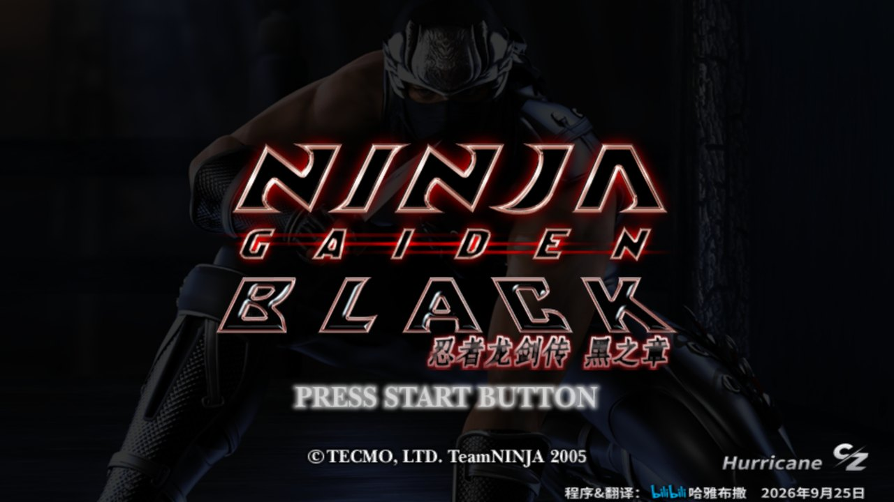
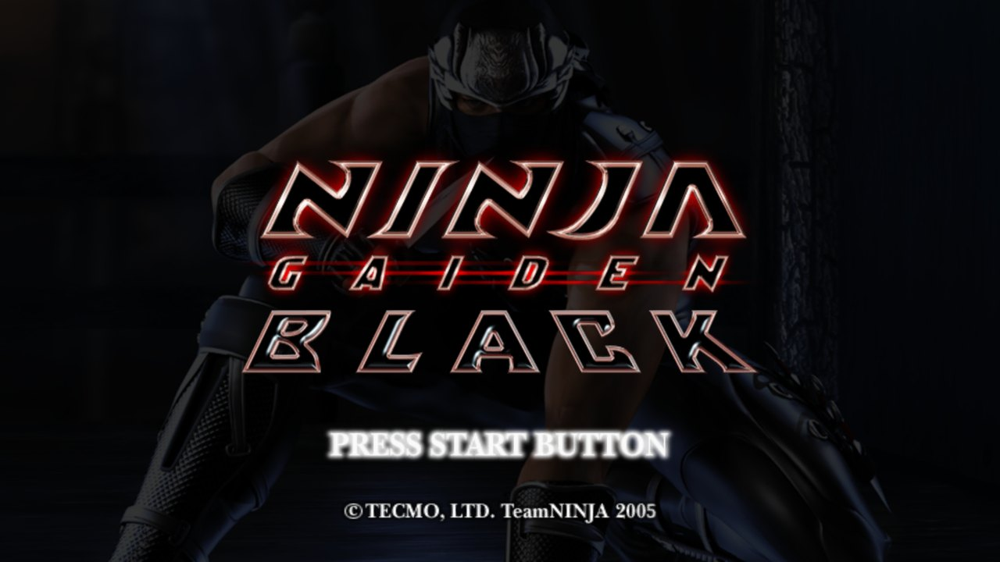
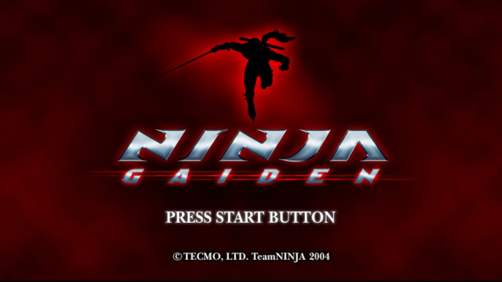

**忍者龙剑传 黑之章**（16:9）

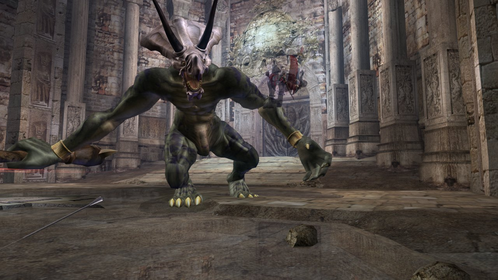
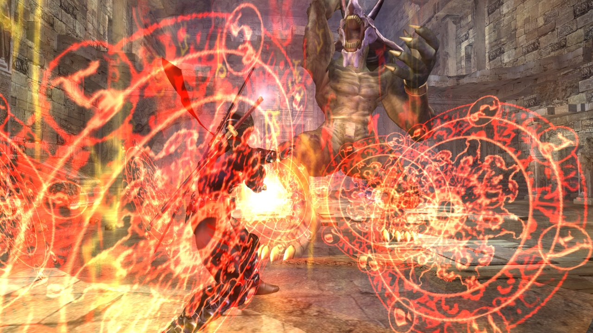
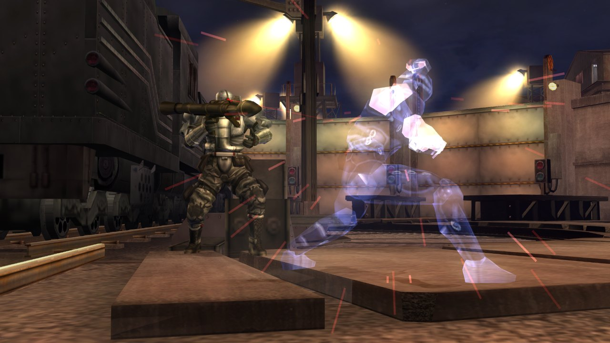

**不同显示比例**（黑之章，同一画面）：4:3、16:9、16:10、21:9。16:10 / 21:9 的画面加宽，血条等界面放在两侧。

4:3 · 16:9

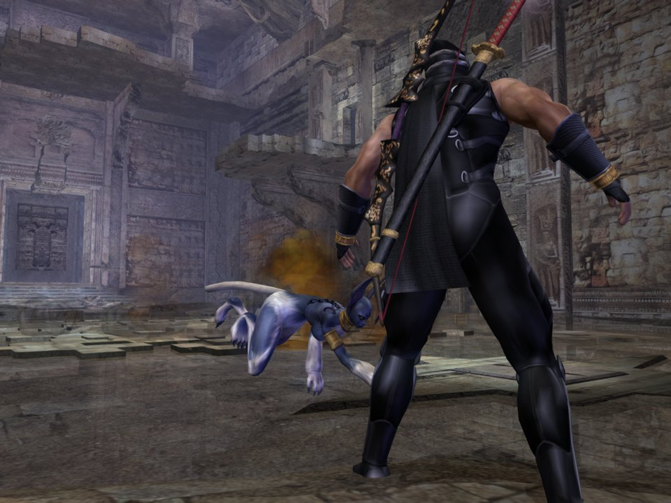
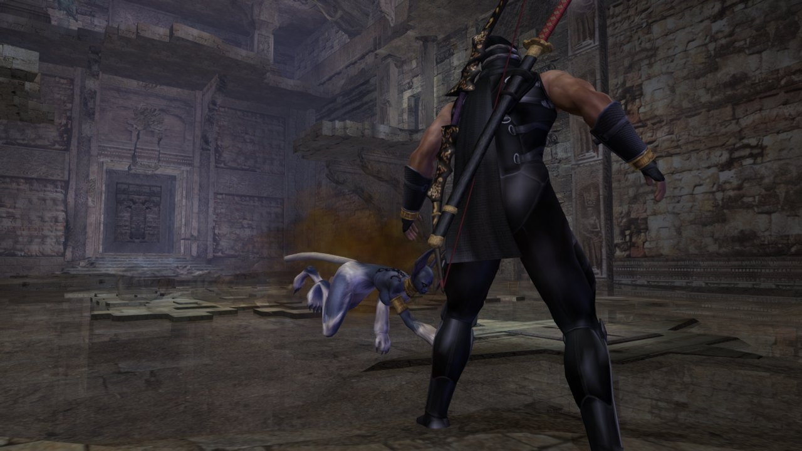

16:10 · 21:9

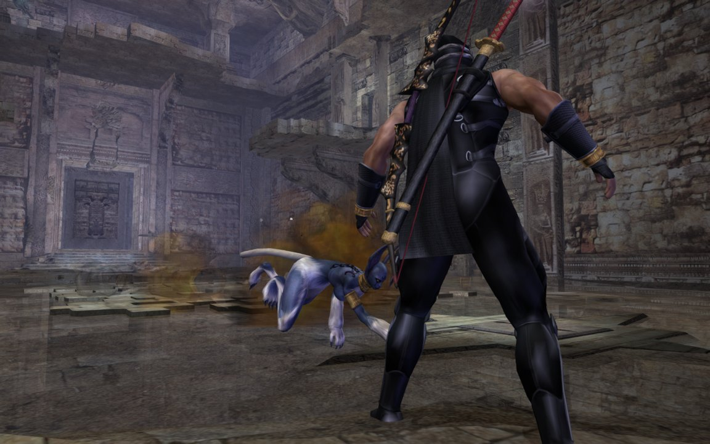
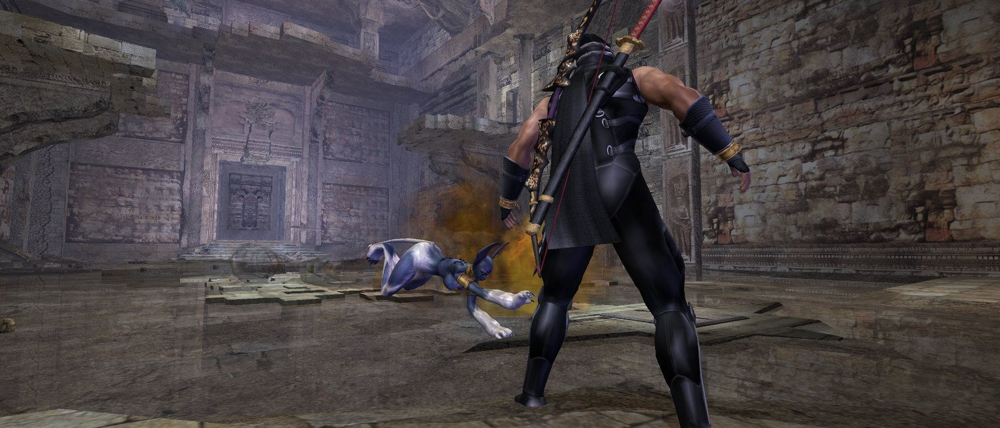

**忍者龙剑传（2004）**：16:9、4:3、21:9 与菜单。

16:9 · 4:3

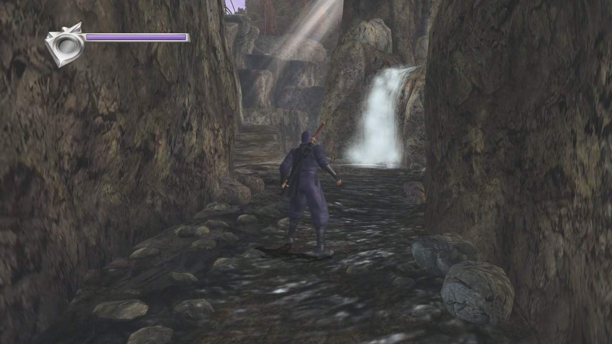
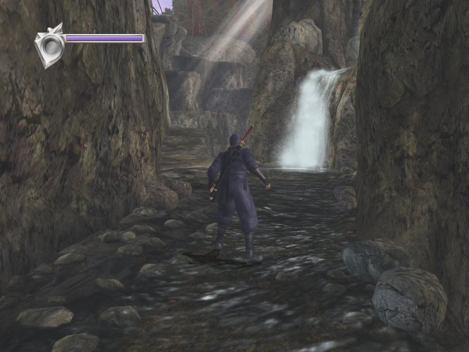

21:9 · 菜单

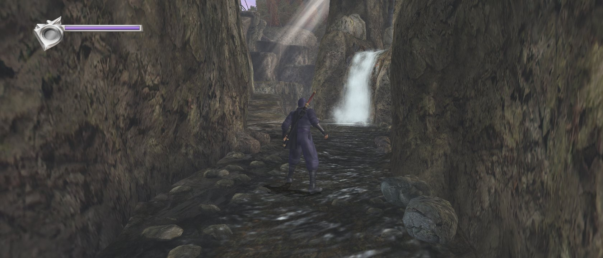
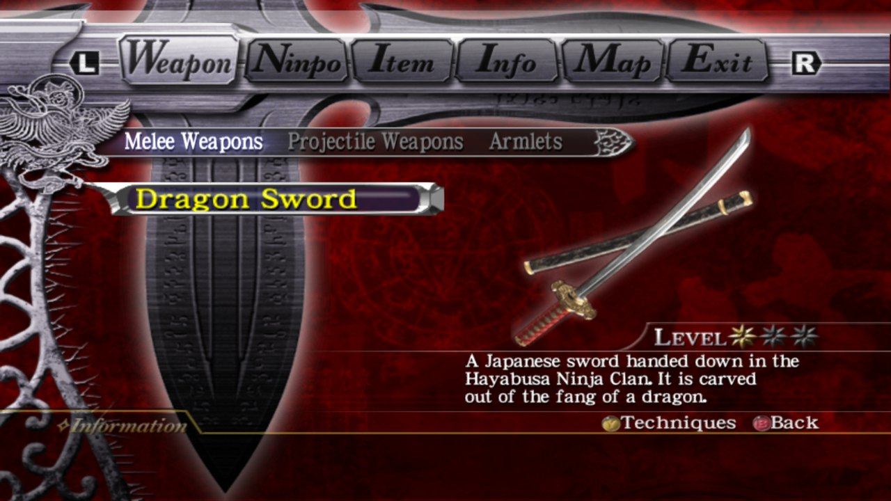

## 下载

- [GitHub Releases](https://github.com/akirahayabusa/ngb-pc-native-port-release/releases)：下载 `ngb-hurricane-pc-2.2.28-win32.zip`。
- 夸克网盘：<https://pan.quark.cn/s/c210df004321>。
- 项目主页：<https://akirahayabusa.github.io/ngb-hurricane-patch/>

`-symbols.zip` 是调试符号，只在回报崩溃时需要。

## 和重编译版有什么不同

原版 `default.xbe` 里的 x86 代码一条不改，直接在 PC 的 CPU 上运行。Xbox 的内核、Direct3D、声音、手柄这些系统部分，由加载器在 PC 上重新实现。

- 游戏逻辑就是原版那份代码，不会因为翻译代码产生新 bug。
- 只需要 Direct3D 9，集成显卡也能跑满 60 帧。
- 街机版（飓风版还有 SFC 三部曲）都能从主菜单进入。
- 存档是标准 Xbox 格式，可以和 xRevive 互导。
- 手柄：Xbox、PS3/4/5、Switch Pro、Joy-Con、DirectInput 手柄都能直接用，都带震动。
- 可选的 Insignia 联网排行榜；2004 的忍者大师锦标赛。2.2.0 起不用 xemu 也能联网：在启动器里新建主机、注册、建玩家代号，或从 xemu 导入账号。
- 存档在启动器里一键重签：别的 Xbox、xemu、别的玩家的存档都能读。

## 怎么玩

1. 下载压缩包，解压到任意位置。
2. 打开 `NGB-Hurricane\Ninja Gaiden Black Any Launcher.exe`，在「安装」页选择你自己的游戏镜像（`.iso`，上面四种之一）安装。玩 2004 先在左上角切换到「2004」，再选 2004 的镜像；飓风包在同一页下面安装。
3. 回到「开始游戏」页开始。装好后也可以直接双击 `Ninja Gaiden Black Any.exe`。

从 1.1.12 或更早的版本升级：1.2.0 起程序改名为 `Ninja Gaiden Black Any.exe` / `Ninja Gaiden Black Any Launcher.exe`，覆盖解压后可以删掉旧的 `Ninja Gaiden Black Hurricane.exe` 和 `Ninja Gaiden Black Hurricane Launcher.exe`，桌面快捷方式要重新建。存档和设置不受影响。

**需要**：Windows 10 / 11（Steam Deck / Linux 见下文），支持 Direct3D 9 的显卡（集成显卡也可以），不用装任何运行库。

**不包含游戏本身**：请使用你自己合法取得的游戏镜像。

完整说明（设定、联网、已知问题）见压缩包里的 `README.md`。

## Steam Deck / Linux

没有单独的 Linux 版，用 Steam 的 Proton 运行 Windows 版。

**Steam Deck**：

1. 切到桌面模式，解压压缩包，按上面的步骤准备好游戏镜像。
2. Steam →「添加游戏」→「添加非 Steam 游戏」，选 `Ninja Gaiden Black Any Launcher.exe`。
3. 右键这个游戏 →「属性」→「兼容性」，勾选「强制使用特定 Steam Play 兼容工具」，选 Proton（试过的是 11.0-2，也可以选 Experimental）。
4. 启动，在启动器里安装或选好游戏路径，再开始游戏。之后在游戏模式里从库里直接启动。
5. Deck 的按键在 Proton 里就是一个 Xbox 手柄。屏幕是 16:10，可在启动器「画面比例」里选「宽屏（16:10 显示器）」。

**其他 Linux**：有 Steam 的话做法同上（第 2–4 步）；不用 Steam 时可用 Lutris、Bottles 或 Wine，建议先 `winetricks dxvk`（游戏用 Direct3D 9，经 DXVK 比 Wine 自带的转换快）。

**目前的情况**：1.1.x 时有 Deck 玩家用 Proton 11.0-2 跑通过，期间修了两处 Proton 与 Windows 的差异（1.1.3 开机报光盘脏污、1.1.4 警告画面后崩溃）；之后的版本还没有 Deck 上的报告。游戏运行时用 Wine/Proton 自带的 `d3dcompiler_47` 编译着色器，如果画面缺东西，可以试 `winetricks d3dcompiler_47`。启动器界面和联网在 Wine 下没有验证过。遇到问题请把游戏文件夹里的 `logs\black.log` 发到 issue。

## 杀毒软件报毒

少数杀毒软件会把 `Ninja Gaiden Black Any.exe` 报成木马。在 VirusTotal 上是七十家里的三五家，都是机器学习或通用启发式规则（例如 Elastic、Malwarebytes、VBA32），没有报出具体的病毒家族；Windows Defender、卡巴斯基、ESET、BitDefender 等都显示干净。

这是误报。游戏程序只是一个占住 Xbox 内存地址的小程序，运行时由 `blackrt.dll` 把原版游戏代码放进这段内存并打补丁，程序也没有数字签名，在这些模型看来像加壳程序。2.2.23 起游戏程序开启了数据执行保护（DEP）并带 manifest，看起来更像普通程序，但误报不保证完全消失。源码全部公开：<https://github.com/akirahayabusa/ngb-pc-native-port>。

- 下载后可以用发布说明里的 SHA-256 核对压缩包，确认文件没被换过。
- 如果被拦截，把游戏文件夹加入杀毒软件的排除列表。
- 详见 [issue #6](https://github.com/akirahayabusa/ngb-pc-native-port-release/issues/6)。

## 法律声明

本项目与 Koei Tecmo、Team NINJA 及 Microsoft 无关，也未获其认可。Ninja Gaiden 是 Koei Tecmo 的商标，Xbox 是 Microsoft 的商标。

程序以 GNU 通用公共许可证第 2 版或（由你选择）任何更新的版本发布，见 `LICENSE`。

开发：哈雅布撒（b 站）
